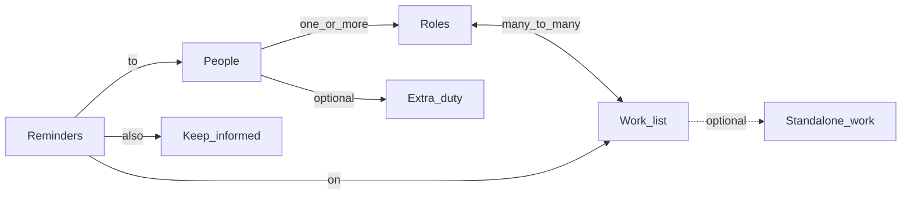

# Work list, Roles, People, Reminders + Labels

Status: **Phase 1–2c implemented** (catalog + reminders + job↔work + area ownership for Jobs).

## Model

- **Work**: regular or temporary duty. System or custom. No required role/person.
- **Role**: lasting. Duties of this role can be changed anytime. Custom roles use `maps_to` for the phone shell.
- **Person**: Add staff; give one or more roles; optional **extra duty** on that person only.
- **Effective work** = duties from all held roles + extra duty.
- **Reminder**: on a work item; notifies people who have that duty; optional Keep informed (admins).
- **Labels**: super admin can rewrite display words and help sentences.

## Data

Migration: `supabase/migrations/20261117190000_society_work_roles_reminders.sql`

- `society_tasks`, `society_roles`, `society_role_tasks`, `society_person_tasks`, `society_reminders`, `society_labels`
- Existing `person_roles` / `profiles.role` stay the login/active-role source of truth for gate/jobs RPCs

## Admin surfaces

| Place | What |
| --- | --- |
| Portal `/account/roles` tabs | People · Work list · Roles · Areas · Reminders |
| Portal `/account/labels` | Super admin — authorable words/sentences |
| Phone People screen tabs | Same four areas + extra duty on a selected person |

## Rules

- Add staff without a role → blocked (existing create/assign flows)
- Detach work from a role → allowed
- Soft-disable linked work; do not remove a role while people still hold it
- Temporary work past `ends_at` → inactive in lists
- Reminder flush: admin “Send due reminders” or push cron (`/api/push/flush`)

## Live jobs (Phase 2 / 2b)

- `work_orders.society_task_id` links a job to a Work list item
- Portal Jobs + phone Tasks: pick from Work list when opening a job
- **Phase 2b:** picking Work defaults **For role** to staff/facility/security from duties of that work; assignee pickers prefer duty holders (role duty ∪ extra duty); portal create form has For role + frequency; job cards show linked Work
- Keep informed: society admins get notifications on open / assign / status

## Areas (Phase 2c)

Migration: `supabase/migrations/20261118120000_society_area_owners.sql`

- `society_area_owners` — who looks after **repairs**, **gate**, **notices** for a period (`starts_at` / `ends_at`, open-ended allowed)
- Seed: repairs → builder (handover later to facility); gate → security (locked); notices → committee
- `can_manage_area` / `require_jobs_manager` — Jobs desk is admin + facility + current repairs owner (not blanket builder forever)
- Portal `/account/roles?tab=areas` and phone People → Areas tab set the period owner
- Portal Jobs nav + phone Admin Tasks open for the current repairs owner

## Later

- Gate linked to Work list duties
- SMS / WhatsApp reminder channels
