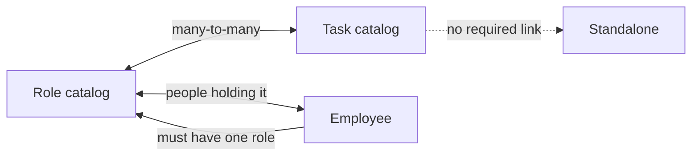

# Employees, Roles, and Tasks (separate + linked)

Status: **planned — do later** (not implemented yet)

Overview: Introduce a community standards catalog of predefined roles and tasks, allow custom additions, and separate admin create flows for Employees, Roles, and Tasks with the dependency rules below.

## Model

- **Task**: standalone catalog item (predefined + custom). No required dependency on role or person.
- **Role**: catalog item (predefined + custom). Linked both ways to **tasks** (what this role does) and **employees** (who holds it).
- **Employee**: person with phone/PIN (or Google). **Depends on a role** — create/assign always picks a role.

Live repair/gate jobs (`work_orders`) stay as today for day-to-day work; they can optionally reference a catalog task later. Phase 1 focuses on the catalog + People wiring.

## Data (new migration under `rv-uddipta-portal/supabase/migrations/`)

- `society_roles` — `id`, `key`, `label`, `summary`, `system` (predefined), `enabled`, `created_at`
- `society_tasks` — `id`, `key`, `label`, `summary`, `system`, `enabled`, `created_at` (no FKs)
- `society_role_tasks` — `(role_id, task_id)` many-to-many
- Seed **community-standard** roles: Security, Facility manager, Service staff, Committee, Builder (Admin stays special / super-assigned as today)
- Seed **standard tasks** e.g. Gate check, Guest entry/exit, Mark staff present, Open repair job, Do assigned repair, Shared-space booking, Society notice/vote — with no role required on insert; seed links attach them to the matching predefined roles
- Keep existing `person_roles` / `profiles.role` text keys in sync with `society_roles.key` for Security/Staff/Facility so gate/jobs RPCs keep working
- Custom role/task get generated keys (`custom_…`); custom roles that need phone shells map to nearest desk type via `maps_to` (`security` | `staff` | `facility` | `committee` | `builder`) so the app knows which screens to open

## Admin create flows (separate)

Three admin surfaces (phone People area + portal Roles):

1. **Tasks** — list/create/edit/enable catalog tasks; no employee or role required
2. **Roles** — list/create/edit predefined+custom roles; attach/detach tasks; see people count
3. **People (employees)** — create/assign person **requires a role**; show role label + linked task summary

Dependency rules in UI + RPCs:

- Creating an employee without a role is blocked
- Detaching a task from a role is allowed; deleting a task used by roles is soft-disable (or block hard delete if linked)
- Removing a role is blocked while employees still hold it
- Tasks never require a role to exist

## App / API touchpoints

- Extend `rv-uddipta-mobile/src/lib/rolesDesk.ts` + People UI (`RolesAssign.tsx`): tabs or entry points for Tasks / Roles / People; keep **?** help in plain language updated to this model
- Portal: `RoleCreateOfficeForm` / roles page split into Tasks + Roles + People sections
- RPCs (security definer): `list_society_catalog`, `save_society_task`, `save_society_role`, `set_role_tasks`, reuse create-employee with `role_key` validation against enabled `society_roles`

## Docs follow-up (when implementing)

- Update `ROLES.md` help diagram: Task (none) → Role ↔ Task and Role ↔ Employee; Employee → Role
- Refresh People **?** copy to match (plain words)

## Out of scope for this pass

- Razorpay / payments
- Replacing every `work_orders` flow with catalog-only jobs (optional `task_id` on work orders can follow once catalog is live)

## Implementation checklist

- [ ] Migration: `society_roles`, `society_tasks`, `society_role_tasks` + community-standard seeds + `maps_to` for custom roles
- [ ] RPCs to list/save tasks, roles, role-task links; validate employee create against enabled roles
- [ ] Split admin UI into Tasks / Roles / People (mobile + portal) with dependency rules
- [ ] Update `ROLES.md` and People ? help to plain-language employee/role/task model
