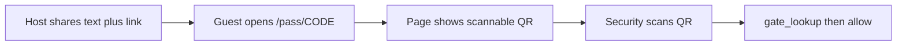

# Gatepass share link + QR

Status: **implemented** (share text includes public link; guest opens QR; security scans)

## Goal

When a host shares a gatepass, the message includes **plain text plus a link**. Opening the link shows the guest QR; security scans that QR to look up and allow the visit.

## Behavior

- Share / WhatsApp message: visitor, home, date, gate code fallback, and `https://{site}/pass/{CODE}`
- Guest-facing QR (mobile + public page) encodes the same full `/pass/{CODE}` URL
- Security scan accepts URL or bare code
- Portal visitors list: Copy link + WhatsApp

## Touchpoints

- Mobile: `rv-uddipta-mobile/src/lib/site.ts`, `PassQr.tsx`, pass detail, invite
- Portal: `app/pass/[code]/page.tsx`, `app/visitors/page.tsx`, `components/PassShare.tsx`, `lib/passShare.ts`

## Out of scope

- SMS gateway, universal/app links for guests, QR image attachment
