# Roles — who sees what and who can do what

This describes how access works across the **website** (`rv-uddipta-portal`) and the **phone app** (`rv-uddipta-mobile`). Behaviour comes from three layers:

1. **Active role** on the person’s profile (`profiles.role`, optional `flat_id`)
2. **Feature switches** (`community_features`) — a feature turned off is closed for everyone
3. **Per-role permissions** (`role_permissions`) — optional overrides set by super admin under **Account → Permissions**

For **Work list / Roles / People / Areas / Reminders** (duties, extra duty, authorable labels, period owners), see [EMPLOYEES_ROLES_TASKS.md](./EMPLOYEES_ROLES_TASKS.md). The Work list can link to live **Jobs** (suggested For role + preferred assignees). **Areas** set who looks after repairs/gate/notices for a period — Jobs follow the current repairs owner (seeded to builder until handover). Gate screens stay security-only.

If no override is saved for a feature, the **defaults** below apply.

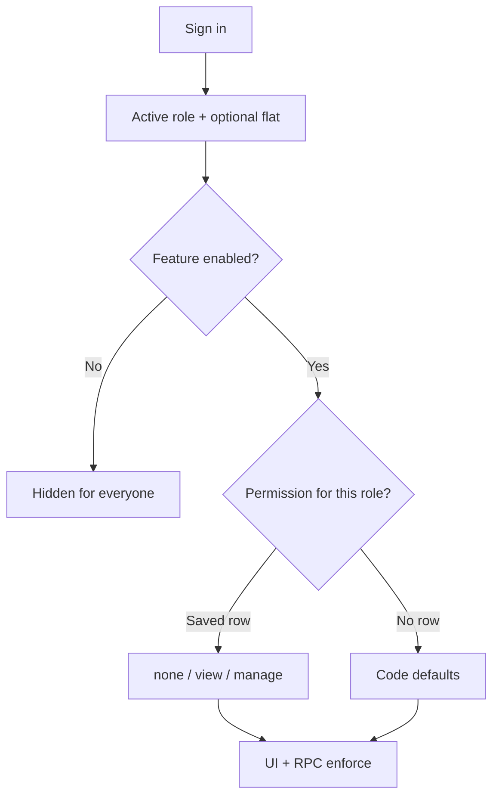

Access levels for a feature:

| Level | Meaning |
| --- | --- |
| **No access** | Feature is hidden |
| **Can look** | Can open and read |
| **Can change** | Can create or update |

A person can hold **more than one role** (`person_roles`) and switch the active one. Flat-linked roles (owner / family / tenant) are tied to a home number.

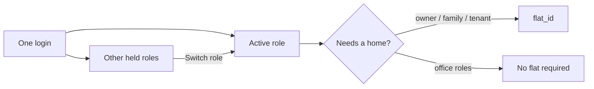

---

## Sign-in paths

| Who | How they sign in |
| --- | --- |
| Residents (owner, family, tenant), visitors, society admin, builder, committee | Google (website + phone) |
| Facility, staff, security (office team) | Usually **phone + PIN** on the app; provisioned by admin |
| Super admin | Google account listed in `ADMIN_EMAILS` / admin phones |

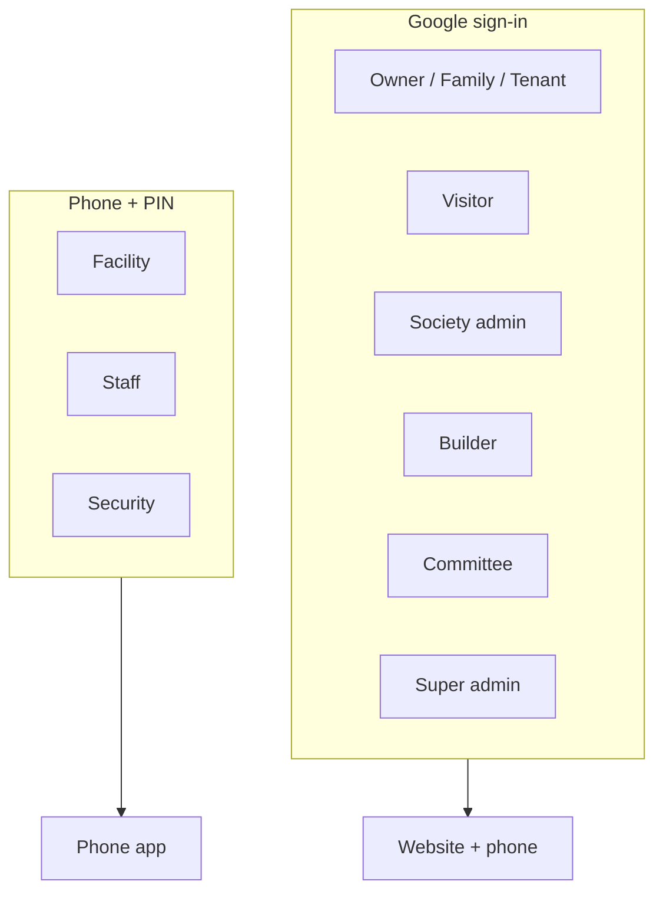

---

## Role map (quick)

| Role | Home after login | Typical place |
| --- | --- | --- |
| **Super admin** | Admin desk only | Platform control — not a society flat |
| **Admin** (society) | `/account` / office on phone | Approvals, flats, billing, team |
| **Builder** | Building details (+ Jobs while repairs owner) | Public project facts; repairs desk until handover |
| **Owner** | Home / feed | That flat’s resident |
| **Family** (`co_owner`) | Home / feed | Same home as owner |
| **Tenant** | Home / feed | Lives in a home; fewer home edits |
| **Visitor** | Join / browse | Signed in, no flat yet |
| **Committee** | Committee | Society decisions |
| **Facility** | Jobs (+ home on phone) | Maintenance desk |
| **Staff** | My work | Assigned jobs only |
| **Security** | Gate | Gate + security ops |

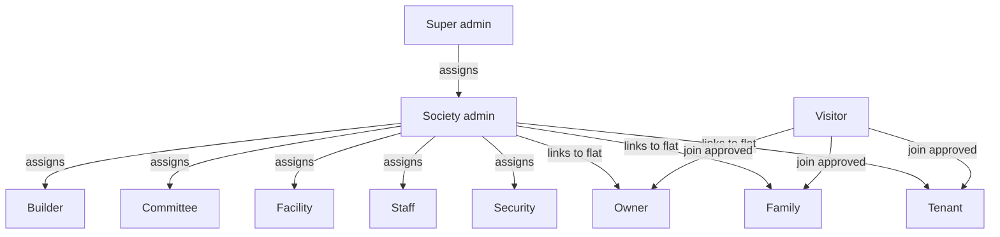

---

## Super admin

Not a `profiles.role` value — detected from env (`ADMIN_EMAILS` / admin phones).

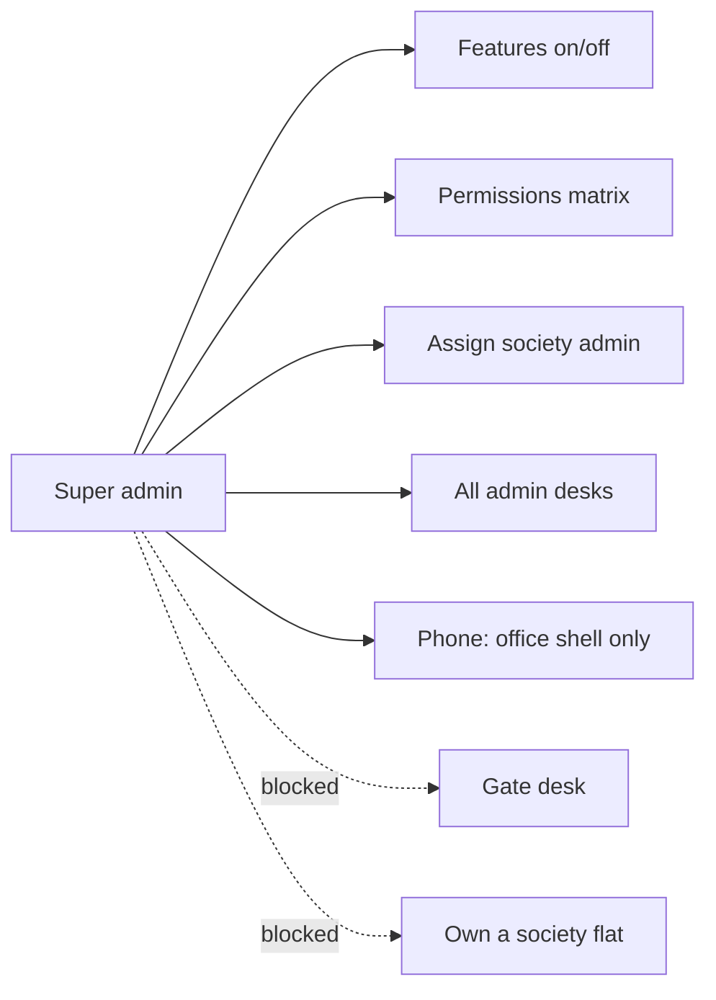

**Can**

- Turn features on/off
- Edit **Permissions** for every role
- Assign **society admin**
- Full admin desks (flats, join requests, reports, audit, categories, …)
- Use the phone **office** shell only (not resident / gate / staff shells)
- Manage everything except the **gate desk** (gate stays security-only)

**Cannot**

- Own or link a society flat on that same login
- Run the security gate as gate staff

---

## Admin (society admin)

Assigned by super admin. Active role `admin`.

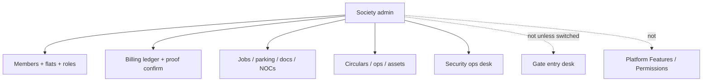

**Can see / do**

- Admin desks: new members, flats, roles (facility / security / committee / staff / builder), requests, forms, jobs, categories, reports, home records, parking, billing, NOCs, workforce, ops, assets, circulars, security ops
- Community features with **manage** by default (when the feature is on)
- Post dues, confirm/reject payment proofs, record office ledger entries
- Publish circulars, ops logs, assets/AMC
- Committee and facility tools as admin

**Cannot**

- Change platform feature toggles / permission matrix (super admin)
- Operate the gate as security (unless they switch to a security role they hold)

**Phone:** office / admin surfaces; may also hold other roles and switch.

---

## Builder

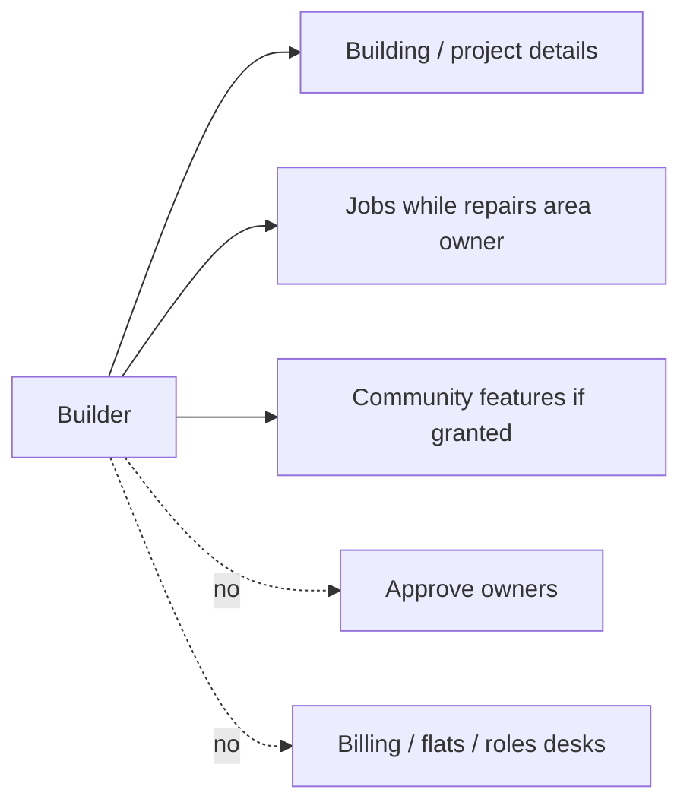

**Can**

- Edit **building / project details** (brochure-style facts the public site shows)
- Run the **Jobs** desk while Areas → Repairs names Builder as the period owner (default seed; change to Facility after handover)
- Use community features that are enabled and granted (default: manage for catalog features, same community fallback as other society roles)

**Cannot**

- Approve owners or assign society admin
- Run billing / flats / roles desks (those are admin)
- Keep Jobs after repairs ownership moves to Facility (or another role)

**Home:** `/account/builder`

---

## Owner

Linked to one sold flat. Primary resident account for that home.

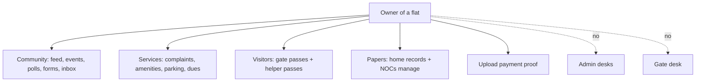

**Can**

- Community: feed, announcements, events, polls, forms, neighbours, inbox (when features are on)
- Services: complaints/requests, amenities booking, parking vehicles, maintenance notices, dues (view invoices + upload payment proof)
- Visitors: create gate passes, approve visitors for their home, helpers/vendors passes
- Papers: home records + NOC requests (**manage**)
- Building ops / circulars when those features are on
- Update flat household details they are allowed to edit

**Cannot**

- Admin desks (flats, roles, dues posting, feature toggles)
- Gate desk
- Edit another home’s records

**Phone home:** resident tabs (Home, Services, …)

---

## Family (`co_owner`)

Family on the same flat as an owner.

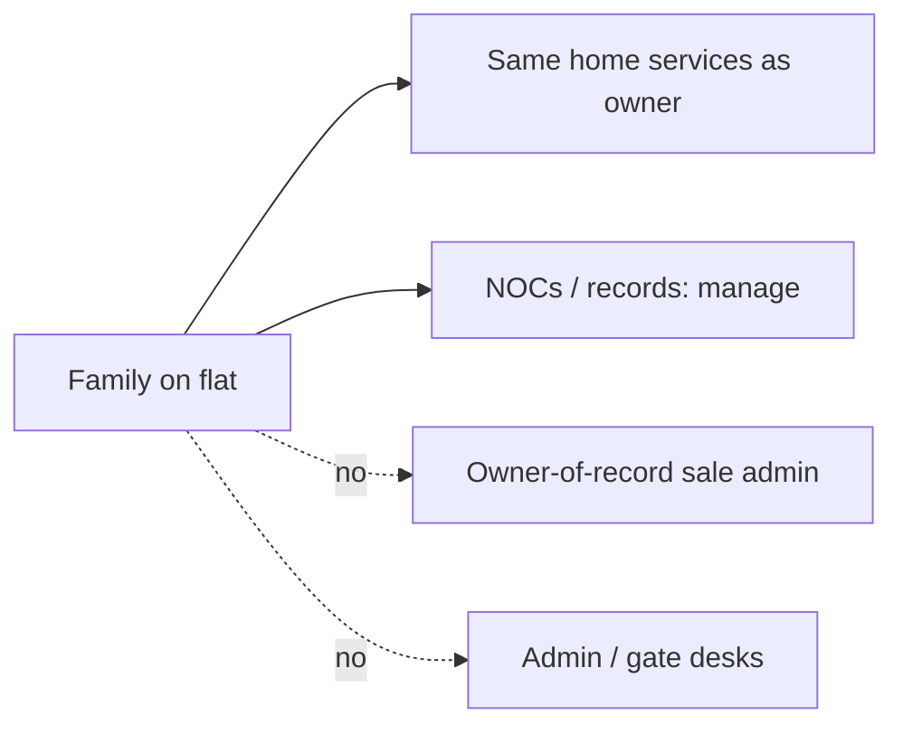

**Can**

- Same community and home services as owner for that flat (passes, parking, dues proof, complaints, etc.)
- Home records / NOCs: **manage** (same as owner by default)

**Cannot**

- Act as the brochure “owner of record” for sale/ownership admin flows
- Admin / gate desks

---

## Tenant

Lives in a flat; not the owner.

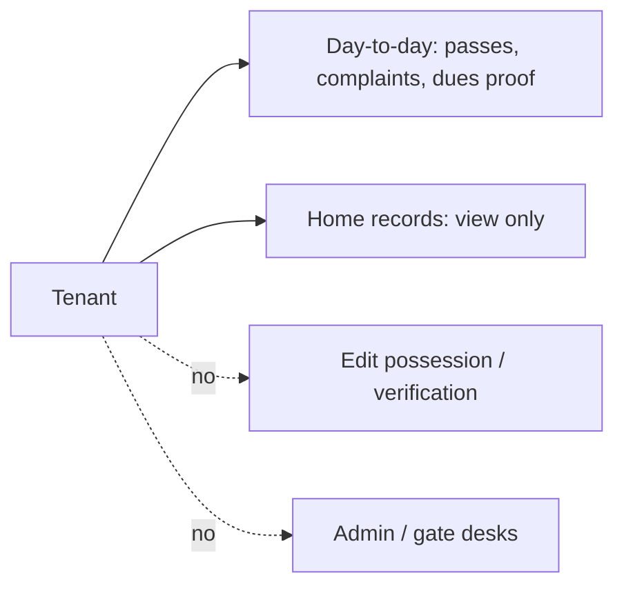

**Can**

- Community and day-to-day services for that home (passes, complaints, amenities, dues view + proof upload, helpers, circulars, …) when features allow
- Home records: **look** only by default (not edit possession/verification notes)

**Cannot**

- Change owner journey / possession-style home record edits (default)
- Admin / gate desks

---

## Visitor (signed in, no flat)

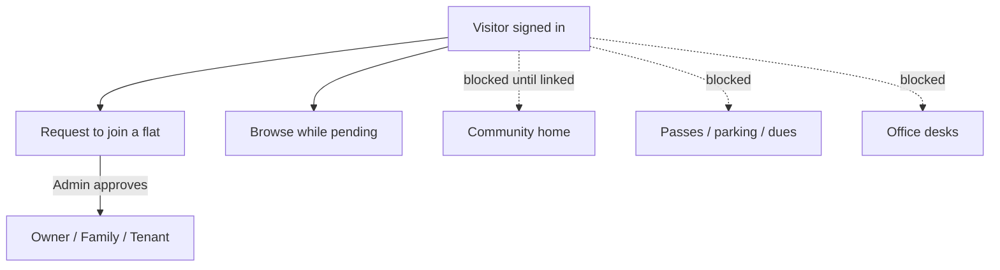

**Can**

- Sign in and request to join a flat (or browse while pending, depending on join state)
- Very limited community until approved and linked

**Cannot**

- See owner directories / private community as a resident
- Create passes, pay-proof, parking, complaints tied to a home
- Any office desk

Until an admin (or join flow) links them as owner / family / tenant, they stay outside the home.

---

## Committee

Society committee member. Not required to be tied to a home (may still hold a home role separately and switch).

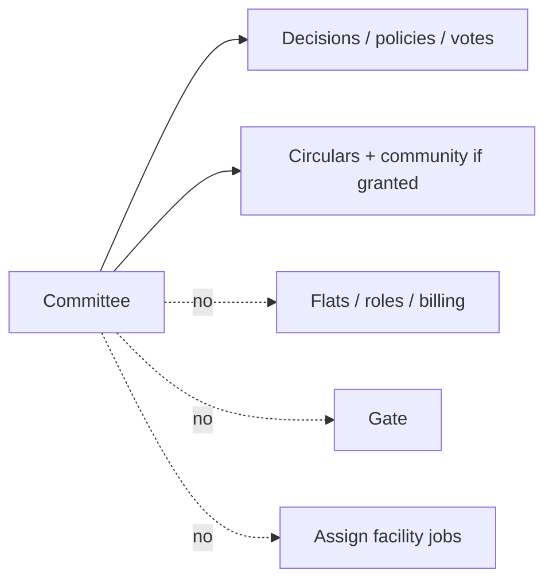

**Can**

- Committee desk: decisions, policies, votes (**manage** on `committee` by default)
- Community features granted by permissions (defaults follow the feature catalog for community roles)
- Circulars / other community tools when enabled

**Cannot**

- Flats / roles / billing admin desks (unless also admin)
- Gate
- Facility job assignment (unless also facility/admin)

**Home:** `/committee` (website); committee entry on phone Services when active.

---

## Facility manager

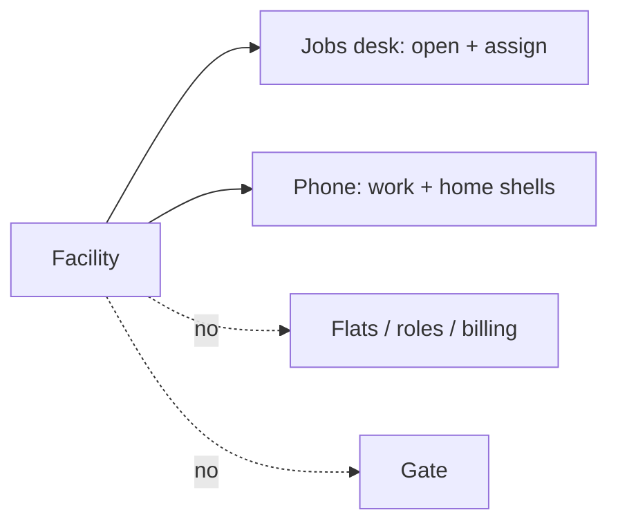

**Can**

- Maintenance **jobs** desk: open work, assign staff (**manage** on `maintenance`)
- Phone: work shell + home (for Manage bookings/jobs under resident routes)
- Other features per permissions defaults

**Cannot**

- Society admin flats/roles/billing (unless also admin)
- Gate

**Home:** `/account/jobs`

---

## Staff (service staff)

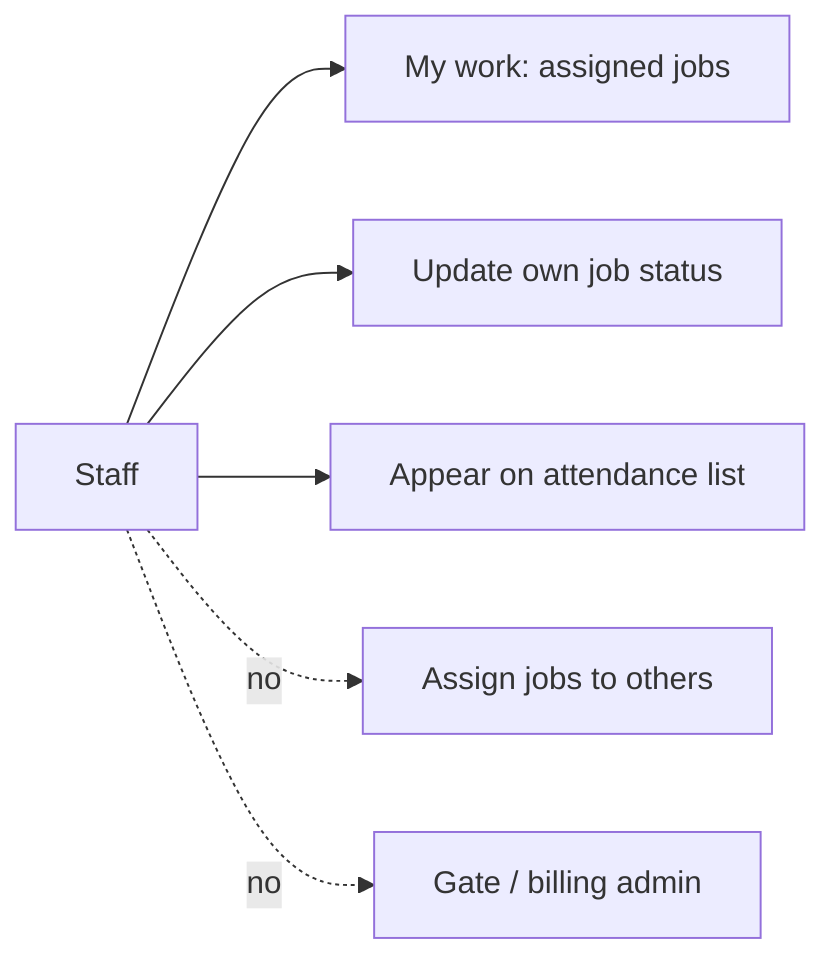

**Can**

- **My work** — jobs assigned to them; update status on their jobs
- Attendance flows used by staff/facility (security marks attendance; staff appear on the list)

**Cannot**

- Assign work to others (facility/admin)
- Resident home services unless they also hold a home role and switch to it
- Gate / billing admin

**Home:** `/work` (website), staff shell on phone

---

## Security

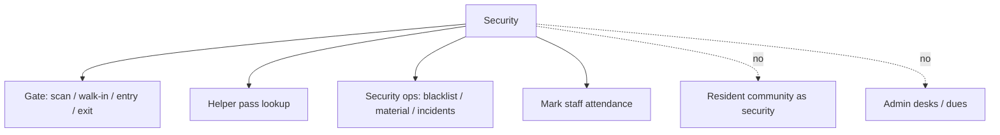

**Can**

- **Gate only** for visitor entry/exit: expected / waiting / inside / left, walk-ins, scan codes
- Look up **helper / vendor pass** codes at the gate
- **Security ops** (when feature on): blacklist, material exit, incidents
- Staff attendance marking at the gate (staff/facility list; security is not listed as attendees)

**Cannot**

- Resident community as their active security role
- Society admin desks
- Record dues / confirm payment proofs

**Hard rule:** `gate` is **security-only**. Society admin and super admin do not get the gate desk while acting as admin.

**Home:** `/gate` (website), security tabs on phone

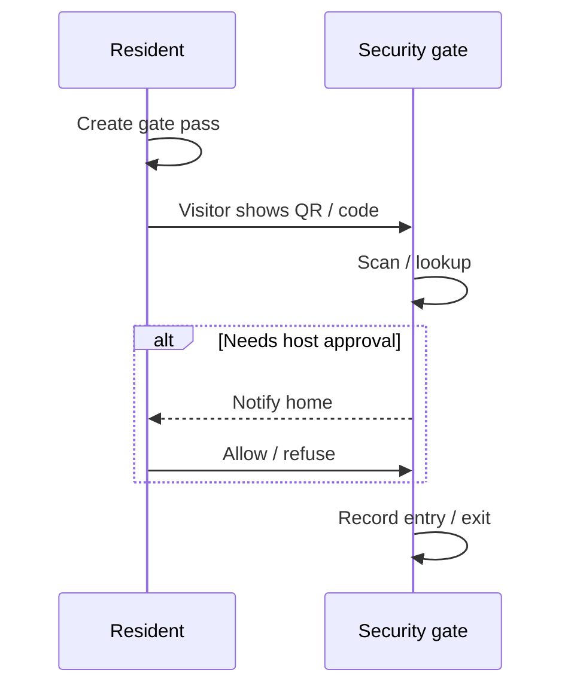

---

## Default feature access (when no permission row is saved)

These are the code defaults in `fallbackDeskAccess`. Super admin can override per role on **Permissions**. A feature switched **off** under Features is closed for everyone.

| Feature | Admin | Owner / Family | Tenant | Committee | Facility | Staff | Security | Builder | Visitor |
| --- | --- | --- | --- | --- | --- | --- | --- | --- | --- |
| Gate | — | — | — | — | — | — | **manage** | — | — |
| Maintenance | manage | —* | —* | —* | **manage** | **manage** | —* | —* | — |
| Committee | manage | —* | —* | **manage** | —* | —* | —* | —* | — |
| Documents / NOCs | manage | **manage** | **view** | —* | —* | —* | —* | —* | — |
| Other catalog features (feed, passes, parking, billing, workforce, ops, assets, circulars, security_ops, …) | manage | **manage**† | **manage**† | **manage**† | **manage**† | **manage**† | **manage**† | **manage**† | — |

\* Falls through to “none” for that special case, unless a catalog catch-all applies.  
† For roles in the community set, any feature key that exists in `FEATURE_CATALOG` defaults to **manage** unless a special rule above says otherwise. In practice, UI still hides desks that are office-only (billing post, jobs assign, …) behind admin/facility checks even when the feature key is visible.

**Always check the product UI + Permissions page** for the live society: overrides and disabled features win over this table.

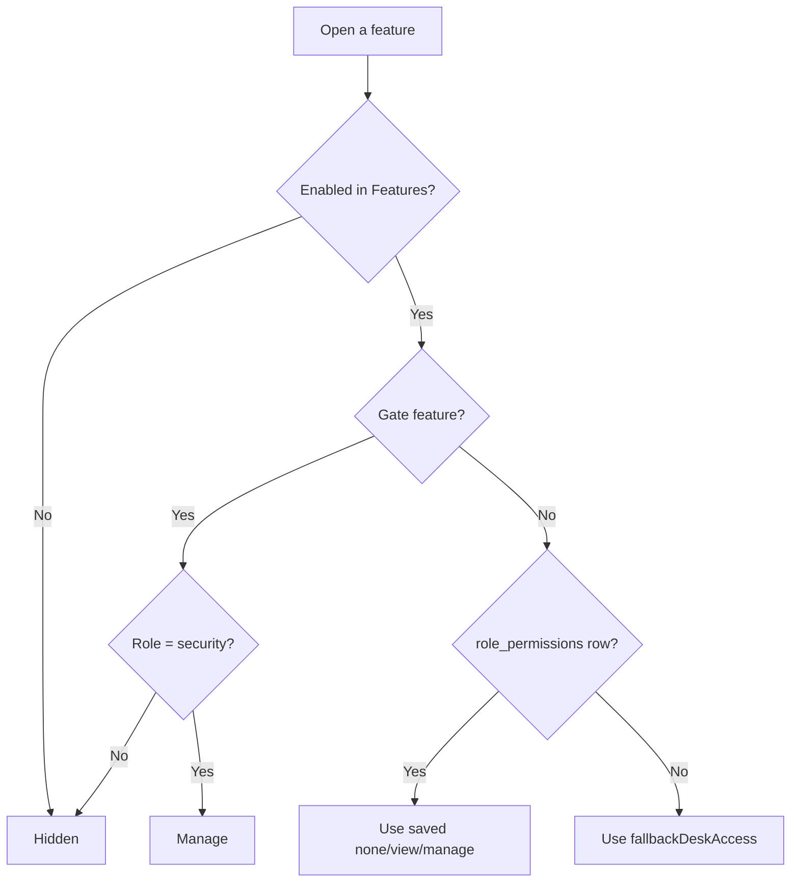

---

## Desks that stay role-locked (even if a feature is on)

| Desk / action | Who |
| --- | --- |
| Gate entry/exit | Security only |
| Post dues / confirm payment proof / fee heads | Society admin (or super) |
| Assign maintenance jobs | Facility or admin |
| Update “my job” | Staff (own jobs), facility/admin |
| Committee decisions | Committee or admin |
| Feature toggles + permission matrix | Super admin |
| Assign society admin | Super admin |
| Assign facility / security / committee / staff / builder | Society admin or super |
| Link owner / family / tenant to a flat | Society admin or super |

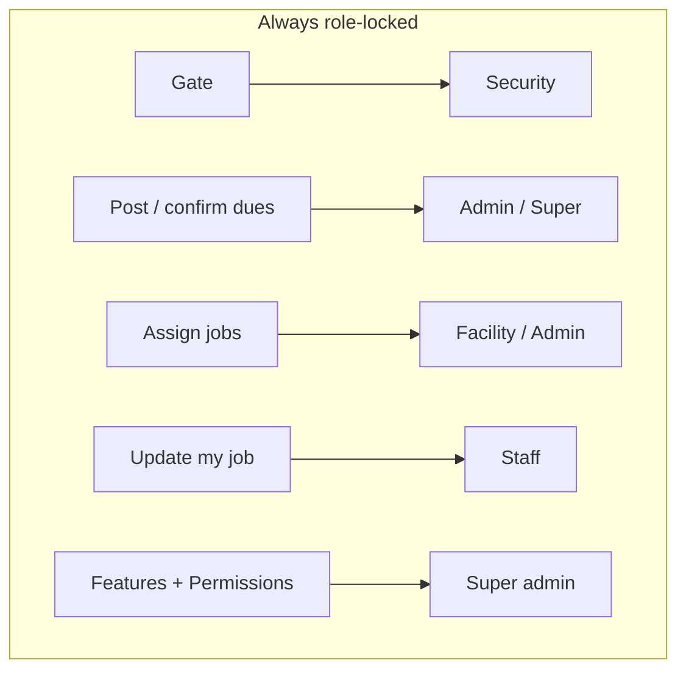

---

## Billing (no online payment)

| Action | Who |
| --- | --- |
| See invoices for own flat | Owner, family, tenant (billing feature on) |
| Upload screenshot/PDF proof | Same; stays **pending** |
| Confirm or reject proof; record office ledger | Society admin |
| Post a dues run / fee heads | Society admin |

There is **no** in-app checkout or payment gateway.

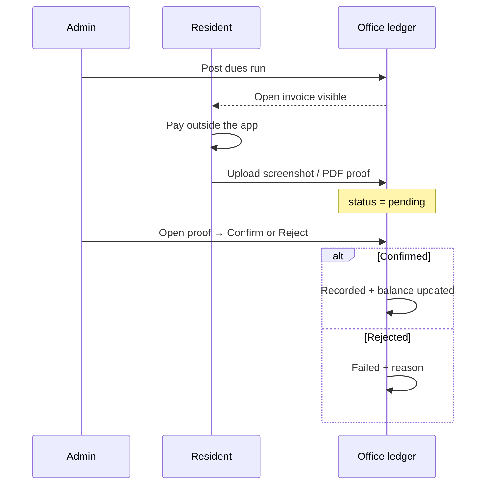

---

## Phone app shells

| Shell | Roles |
| --- | --- |
| `(resident)` home | Owner, family, tenant, admin, builder, committee, facility, visitor (limited) |
| `(security)` gate | Security |
| `(staff)` work | Staff, facility, admin |
| `(super)` office | Super admin only |
| `(public)` join/browse | Visitor join flow |

Switching roles on the account changes the active shell and API access.

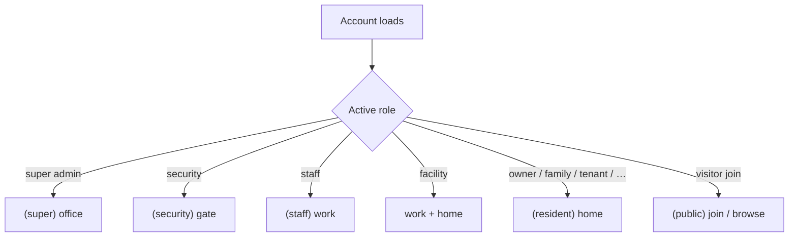

---

## Practical examples

1. **Owner of A101** creates a gate pass → security scans it at the gate → owner gets “approve visitor” if required → security records entry/exit.
2. **Tenant** uploads a UPI screenshot on Dues → admin opens proof → Confirm → invoice balance updates.
3. **Facility** assigns a plumbing job → **staff** sees it under My work and marks progress.
4. **Security** looks up helper code `W…` → if active and not blacklisted, allow entry (no visitor-pass status machine).
5. **Super admin** turns off Amenities → nobody can book, regardless of role.

```mermaid
flowchart LR
  subgraph Example_maintenance["Maintenance job"]
    FA[Facility] -->|assign| ST[Staff]
    ST -->|update status| JOB[Work order]
  end
```

```mermaid
flowchart LR
  subgraph Example_helper["Helper at gate"]
    OW[Owner] -->|add helper pass| W[Code W…]
    SE[Security] -->|lookup| W
    W -->|allowed| IN[Entry]
  end
```

---

## Where this is configured in the product

| Setting | Where |
| --- | --- |
| Turn features on/off | Account → Features (super admin) |
| Per-role view/manage/none | Account → Permissions (super admin) |
| Assign society roles | Account → Roles |
| Link people to flats | Account → Flats / New members |
| Env super admins | `ADMIN_EMAILS` / `ADMIN_PHONES` |

```mermaid
flowchart LR
  SA[Super admin] --> Feat[Features]
  SA --> Perm[Permissions]
  SA --> Adm[Society admin]
  Adm --> Roles[Roles desk]
  Adm --> Flats[Flats / members]
  Roles --> Team[Facility / Staff / Security / …]
  Flats --> Homes[Owner / Family / Tenant]
```

Code references: `lib/roles.ts`, `lib/deskAccess.ts`, `lib/roleLabels.ts`, `lib/features.ts`, mobile `lib/place.ts`.
